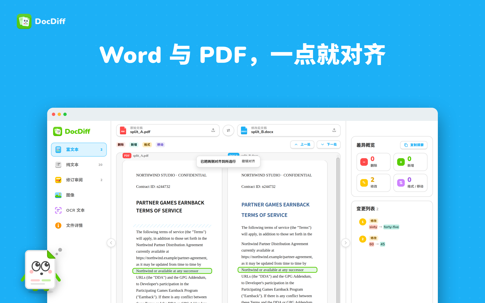

# DocDiff

**每一处不同，一眼看清。** DocDiff 可以比较 DOCX、PDF、TXT 文档，格式不同的两份文件也能互比。文档处理在你的电脑上完成，无需上传文件或注册账号。支持中文和 English 界面。

[下载最新版](https://github.com/evonotevil/DocDiff/releases/latest) · [产品主页](https://evonotevil.github.io/DocDiff/) · [更新记录](CHANGELOG.md)

> **首次运行提醒：目前的 macOS 和 Windows 安装包尚未签名。** 请从本仓库的 Releases 下载，并按需核对随版本提供的 `SHA256SUMS.txt`。
>
> - **macOS：** 如果首次打开时提示“无法验证开发者”或“Apple 无法检查 App 是否包含恶意软件”，先尝试打开一次，再到 **系统设置 → 隐私与安全性**，在底部找到 DocDiff，点 **仍要打开**，随后确认 **打开**。[Apple 官方说明](https://support.apple.com/zh-cn/102445)
> - **macOS 补充方法：** 如果仍无法打开，确认应用已拖入“应用程序”且下载文件来自本项目 Release 后，也可以在“终端”运行 `xattr -cr /Applications/DocDiff.app`，然后重试。
> - **Windows：** 如果运行安装包时出现“Windows 已保护你的电脑”，确认文件来自上方的 Release 页面后，点 **更多信息 → 仍要运行**。如果没有继续选项，请在 [Issues](https://github.com/evonotevil/DocDiff/issues) 反馈，不必关闭系统的安全保护。

## 主要功能

- **跨格式比对**：DOCX、PDF、TXT 可以任意组合。按需查看文字、格式、页面布局或扫描件上的差异。
- **逐条审阅修订**：接受、拒绝或标为待议，可添加备注。审阅记录自动保存在本机，下次可以继续。
- **查看和回复 Word 批注**：在富文本和修订审阅中查看批注及回复，点批注可定位到对应文字。在修订审阅中回复对方，生成 Word 审阅稿时会把回复写回原批注。
- **管理往来稿和模板**：给往来稿加入新版本，从版本链选两版比较。常用底稿可存为模板，方便和后续来稿比较。
- **定位重点变化**：按条款或变更类型查看差异，搜索两侧文档，也可在格式变更过多时切换到「只看文字修改」。风险摘要会提示金额、日期和自定义关键词等变化。
- **导出审阅结果**：可生成 Word 审阅稿、审阅后定稿、审阅记录存档或 PDF 比对报告。发出审阅稿前，可检查并排除我方内部批注。

## 下载与安装

当前版本：**v1.9.8**。支持 macOS 11 及以上、Windows 10 / 11（64 位）。

| 你的电脑 | 下载文件 | 安装方式 |
|---|---|---|
| Mac，Apple 芯片 | [mac-arm64.dmg](https://github.com/evonotevil/DocDiff/releases/download/v1.9.8/DocDiff-1.9.8-mac-arm64.dmg) | 打开 DMG，将 DocDiff 拖入“应用程序” |
| Mac，Intel 芯片 | [mac-x64.dmg](https://github.com/evonotevil/DocDiff/releases/download/v1.9.8/DocDiff-1.9.8-mac-x64.dmg) | 同上 |
| Windows 安装版 | [DocDiff-Setup-1.9.8.exe](https://github.com/evonotevil/DocDiff/releases/download/v1.9.8/DocDiff-Setup-1.9.8.exe) | 双击安装，可选择安装位置 |

不确定 Mac 的芯片类型？点屏幕左上角苹果菜单，选择“关于本机”查看。下载文件无法打开或提示损坏时，先从 [Release 页面](https://github.com/evonotevil/DocDiff/releases/tag/v1.9.8)重新下载，并用该版本的 `SHA256SUMS.txt` 核对文件。

## 三步开始比较

1. 将两份文档拖入“原始文档”和“修改后文档”，或点击“选择文件”。
2. 点击 **查找差异**。删除、新增和修改会以不同颜色标出；右侧变更列表和文档边缘的差异地图可以快速跳到对应位置。
3. 按需要切换对比模式。要逐条决定是否保留修改，进入“修订审阅”，完成后导出结果。

## 能比较什么

| 模式 | 适合的场景 |
|---|---|
| 富文本 | 查看合同、报告中的文字和格式变化，保留标题、列表、表格等结构，支持查看 Word 批注。点击对应行可让两侧对齐。 |
| 纯文本 | 专注逐行文字差异，可切换并排或合并视图，并隐藏未变化内容。 |
| 修订审阅 | 逐条接受、拒绝或撤销修改，可回复 Word 批注并导出审阅结果。 |
| 图像 | 按页面查看排版、图片、分页等视觉变化，支持并排、差异、淡化和滑块视图。 |
| OCR 文本 | 先离线识别扫描件或图片型 PDF 中的中文、英文，再比较文字。 |
| 文件详情 | 比较文件大小、时间、SHA-256，以及可读取的文档属性。 |

DOCX、PDF、TXT 可以任意组合。比较时可设置忽略空白、忽略全角与半角标点，并选择按词或按字符高亮。

## 日常使用

- **定位变化：** 点击右侧变更列表或差异地图，跳到对应内容；在富文本里点击一行，还能对齐两侧文档。
- **处理修订：** 按 `A` 接受、`R` 拒绝、`H` 标为待议、`N` 写备注、`U` 撤销最近一次决定。审阅记录自动保存在本机，可导出 Word 修订稿、定稿或 PDF 报告。
- **继续工作：** Word 文件修改并保存后，点击应用内的“重新比较”；“最近比较”可重新打开之前的文件组合。
- **分享结果：** 点击“复制摘要”，将变更整理成 Markdown，粘贴到邮件、聊天或文档中。
- **调整界面：** 侧栏可收成图标栏，差异检查器可以隐藏；在“设置”中切换中文 / English、浅色 / 深色界面，并查看全部快捷键。按 `?` 打开快捷键速查。设置中的“关于与更新”可检查新版本、查看更新日志并打开下载页。

## 常见问题

**文件会上传吗？** 不会。文档比对和 OCR 都在本机完成。下载应用和访问 GitHub 页面需要网络，使用已安装的应用比较文档不需要。启动时默认检查更新，仅请求公开的版本 JSON，不携带文档内容、文件名或路径；可在设置中关闭自动检查。

**支持旧版 `.doc` 吗？** 暂不支持。请先在 Word 中另存为 `.docx`。

**为什么 PDF 和 Word 的段落或分页有时对不上？** PDF 不包含可靠的段落结构，DocDiff 会根据版面推断；复杂多栏文档可能不够准确。DOCX 的图像模式由本机排版，分页也可能与 Word 略有不同。

**可以查看和回复批注吗？** Word 批注及已有回复会显示在富文本和修订审阅中。即使两份文件只有批注差异，也可以在修订审阅中定位和查看。审阅时回复对方的批注，生成 Word 审阅稿时会写入原批注对话。纯文本、图像和 OCR 模式不显示批注。PDF 注释暂不支持。

**导出后会保留批注吗？** Word 审阅稿可以保留批注和回复，发出前可选择排除我方内部批注。审阅记录存档保留批注和回复，PDF 比对报告附批注清单，导出定稿时会移除批注。

**比较范围还有哪些限制？** 页眉、页脚和脚注可参与比较（单页 PDF 除外）。

遇到其他问题，请到 [Issues](https://github.com/evonotevil/DocDiff/issues) 反馈。项目采用 [MIT License](LICENSE)。
